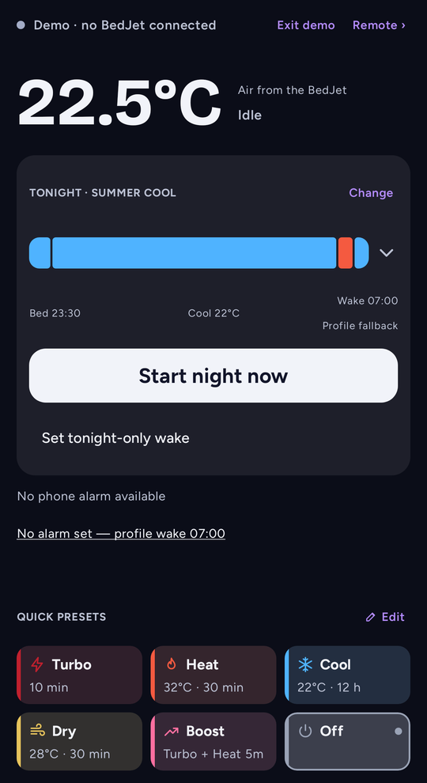
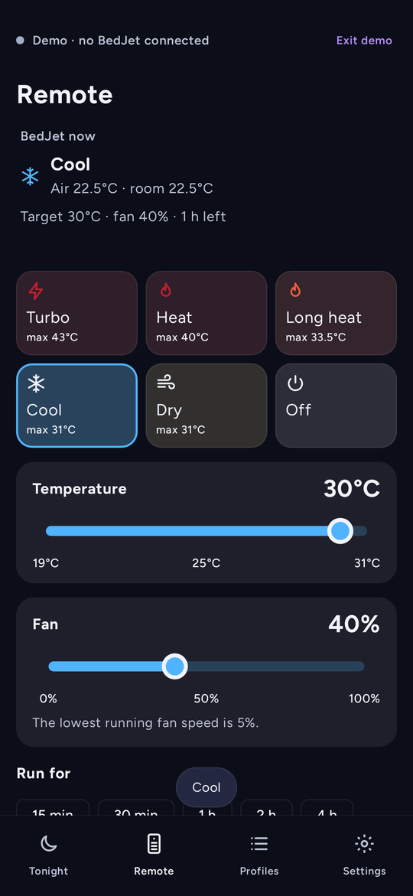
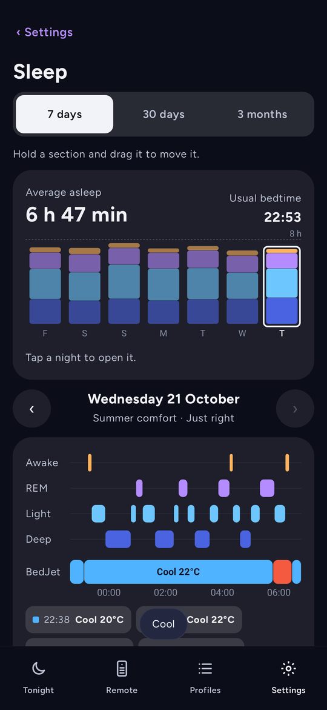
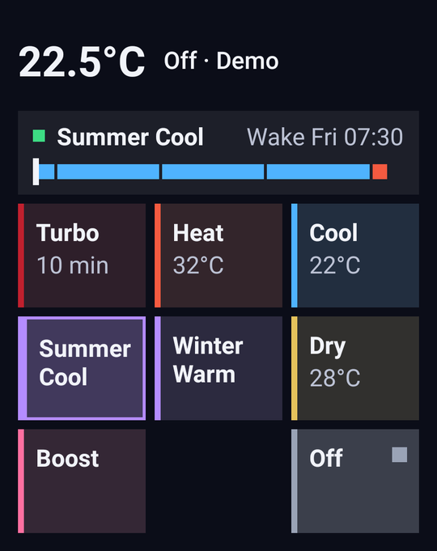

# Nocturne

**A free, open-source Android app for the BedJet 3 that plans each night around your alarm.**

[](https://github.com/Willzy12h/bedjet-android/releases)
[](https://willzy12h.github.io/bedjet-android/demo/)

Set up a night profile once. Every evening Nocturne fits it to when you go to bed and when your Samsung or Google
Clock alarm goes off, writes it to the BedJet, and lets the BedJet run it on its own. Your phone can go to sleep too.

Bluetooth only. No account, no cloud, no internet permission. Not affiliated with or endorsed by BedJet LLC.

<p align="center">
  
  
  
  
</p>
<p align="center"><sub>Rendered against the simulated BedJet used by the tests.</sub></p>

**[Try the interactive demo →](https://willzy12h.github.io/bedjet-android/demo/)** An HTML version of the app you can
tap through in a browser, with a pretend BedJet and a clock you can run through the night. It isn't the app itself and
may lag behind the latest build.

**[See every screen →](https://github.com/Willzy12h/bedjet-android/blob/gallery/README.md)** Every tab, page, sheet,
menu and widget in the Midnight Ink palette. It is re-rendered automatically after each change to `main`.

## Download

1. On your phone, open [Releases](https://github.com/Willzy12h/bedjet-android/releases), pick the newest one at the
   top and download `nocturne-<version>.apk` from its Assets.
2. Open the file. Android asks you to allow "Install unknown apps" for your browser or file manager the first time.
3. Open Nocturne. The **Tonight** screen lists anything still to set up: Bluetooth, notifications, alarms and
   reminders, your alarm app and battery use.

Requires Android 12 or newer and a BedJet 3. Earlier BedJet models use a different protocol and are not supported.

Updates install over the top as long as they are signed with the same key as the version you have. Settings →
Updates opens the Releases page; the app never checks or downloads anything by itself.

## What it does

- **Night profiles** in four parts. *Start* runs any phases, for example Turbo then Heat to warm the bed.
  *Middle* stretches or shrinks to fill the night. *Wake-up* ends exactly at your alarm. *After wake* is optional,
  for example keep warm for 30 minutes. Every profile has fan and temperature limits that the whole night stays
  inside. Seasonal presets are included to start from.
- **Follows your alarm.** Nocturne reads the next alarm from the clock app you choose. If you move the alarm during
  the night, the plan on the BedJet is rewritten. With no alarm it uses the profile's own wake time.
- **Runs on the BedJet itself.** Tonight's plan goes into one BedJet programme slot (slot 3 by default). The first
  time a slot is overwritten, what was in it is saved so you can put it back.
- **Waits for the BedJet.** Commands connect first and only count as done when the BedJet reports back. If it
  can't be reached, nothing is sent and the app tells you so.
- **Remote** for mode, temperature, fan and run time, with a **Max** option for the longest run the mode allows,
  plus **Boost** (Turbo, then Heat).
- **Morning check-in.** Tell it the night was too hot, just right or too cold, and it offers to lower or raise that
  profile's *Middle* by 1 °C for future nights. Nothing changes unless you accept.
- **Wake-up notification** with up to three buttons you choose: snooze or extend warm or cool, or Off.
- **Widgets**: a controls widget that grows from one button to a full list, and a single-button widget. When the
  BedJet is out of range the widget goes grey; a tap reconnects and then runs what you tapped (an action that
  needs your confirmation only reconnects, so you can tap it again once it is green).
- **Shortcuts** for Start tonight, Turbo, Boost and Off, usable from Samsung Modes & Routines and Bixby, and a
  **Quick Settings tile** that shows tonight's status and opens the app.
- **Auto-start** at a fixed time or a set time before your alarm, optionally only while charging, and a
  **bedtime reminder**.
- **Keep a profile on the BedJet.** Write a profile to a spare programme slot as a fixed programme the BedJet
  keeps. What was in the slot is saved first so you can restore it.
- **Sleep page** showing your BedJet nights over 7 days, 30 days or 3 months, with Health Connect sleep stages
  alongside if you turn that on. You choose how long nights are kept (7 days to 1 year); they are stored only on the phone.
- **Palettes and themes**: seven colour palettes, separate night and day palettes on a schedule, and Light, Dark or
  System theme.
- **Backups**: automatic and manual snapshots, and export/import to a file you choose.

## Permissions

| Permission | Why |
| --- | --- |
| Nearby devices (Bluetooth scan and connect) | Find and talk to your BedJet. Scanning is declared as not used for location. |
| Notifications | Night status and the wake-up buttons. |
| Foreground service (connected device) | Keep the Bluetooth link open while a command or night change is in progress. |
| Alarms and reminders (`SCHEDULE_EXACT_ALARM`) | Start and change the night on time. You grant it in Settings; without it Nocturne uses a looser timing window. |
| Ignore battery optimisation | Lets overnight alarm changes reach the BedJet. Recommended on Samsung phones. |
| Run at start-up | Re-arm tonight's schedule after the phone restarts. |
| Companion device presence | Optional. Lets Android tell Nocturne when your BedJet comes back into range, so the widget wakes up. |
| Health Connect (sleep, read and write) | Optional and off by default. Read: show sleep stages on the Sleep page. Write: record completed BedJet programmes. |

Android libraries add two more: keep the processor awake briefly for background work (wake lock) and read whether
the phone has a network (network state). There is no internet permission.

## Privacy

Everything stays on your phone. Nocturne has no servers, accounts, analytics, advertising or crash reporting, and
cannot connect to the internet. See [PRIVACY.md](PRIVACY.md) for the full policy.

## Safety and limitations

- Nocturne controls a heating and cooling appliance. The BedJet's own safety limits always apply, but you are
  responsible for the settings you choose. Keep a normal alarm for anything that matters.
- Android decides when background work runs. Battery savers, especially on Samsung phones, can delay overnight
  changes. Set Nocturne's battery use to **Unrestricted** if alarm changes don't reach the BedJet.
- Android only exposes the *next* alarm, so Nocturne can't see a later alarm behind it.
- One phone at a time: close the official BedJet app (or another phone running Nocturne) while Nocturne is
  connected.
- Tested on Samsung phones with a BedJet 3. Other phones and firmware should work but haven't been checked by us.

This software is provided as is, without warranty. See [LICENSE](LICENSE).

## Build from source

You need JDK 17 or newer (CI uses 21) and the Android SDK (API 36).

```bash
./gradlew :core:test                 # protocol, planner and night logic (plain JVM)
./gradlew :app:testDebugUnitTest     # screens and widgets on Robolectric
./gradlew :app:assembleDebug         # app/build/outputs/apk/debug/app-debug.apk
```

`gradle/verification.init.gradle` reproduces the test isolation CI uses:
`./gradlew --init-script gradle/verification.init.gradle :app:testDebugUnitTest`.

| Path | What it is |
| --- | --- |
| `core/` | Pure Kotlin: BedJet 3 protocol, plan compiler, wake resolution, night runner, simulated BedJet, backups |
| `app/` | Android: Bluetooth link, foreground service, alarms and notifications, Compose screens, Glance widgets |
| `.github/workflows/` | CI: build, tests, release-manifest audit and screenshot checks |
| `docs/screenshots/` | Reference screenshots the CI screenshot check compares against |
| `docs/demo/` | The interactive HTML demo, served by GitHub Pages (see [docs/demo/README.md](docs/demo/README.md)) |

### Signing your own build

`assembleRelease` produces a minified, unsigned APK unless `NOCTURNE_KEYSTORE` (keystore path),
`NOCTURNE_KEYSTORE_PASSWORD`, `NOCTURNE_KEY_ALIAS` and `NOCTURNE_KEY_PASSWORD` are set. An incomplete signing setup
fails the build rather than falling back to a debug key.

A build you sign yourself has a different key from the published APK, so Android won't install it over the
published one: export a backup in Settings, uninstall, install yours and import the backup.

Releases are published by CI. When a change merges into `main` and `release.properties` names a version that has no
`v<versionName>` tag yet, CI builds and tests it, signs it, creates the tag and publishes the release with
`nocturne-<versionName>.apk`, using `docs/releases/<versionName>.md` as the notes. A version with a hyphen, such as
`1.2.0-beta.1`, is published as a pre-release. To release, raise `versionName` and `versionCode` (which must be higher
than every published release) in a pull request. Signing needs the repository secrets `NOCTURNE_KEYSTORE_BASE64`,
`NOCTURNE_KEYSTORE_PASSWORD`, `NOCTURNE_KEY_ALIAS` and `NOCTURNE_KEY_PASSWORD`, and the variable
`NOCTURNE_RELEASE_CERT_SHA256` (the expected signer). Pushing a `v*` tag by hand still works too, with the variable
`NOCTURNE_RELEASE_VERSION_CODE` as its versionCode.

## Contributing and forks

Issues and pull requests are welcome, and you're free to fork it under the [MIT licence](LICENSE). Please keep a
fork's application ID and name distinct so people don't confuse the two.

## Credits

The BedJet 3 protocol comes from [Lull](https://github.com/rkanjani/lull) by Rohan Kanjani (MIT), which worked it out
from the official app. Nocturne ports Lull's protocol encoding, heat cut-off table and simulated BedJet; see
[NOTICE](NOTICE). Fonts are Figtree and Bricolage Grotesque under the SIL Open Font Licence
([docs/licences](docs/licences)).

BedJet is a trademark of BedJet LLC. This project is independent and unofficial.
